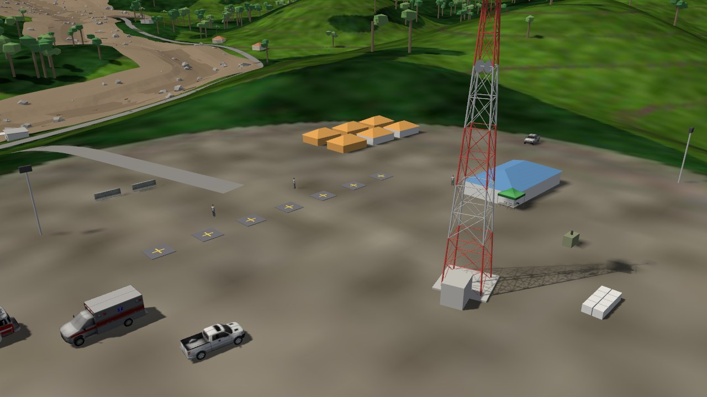
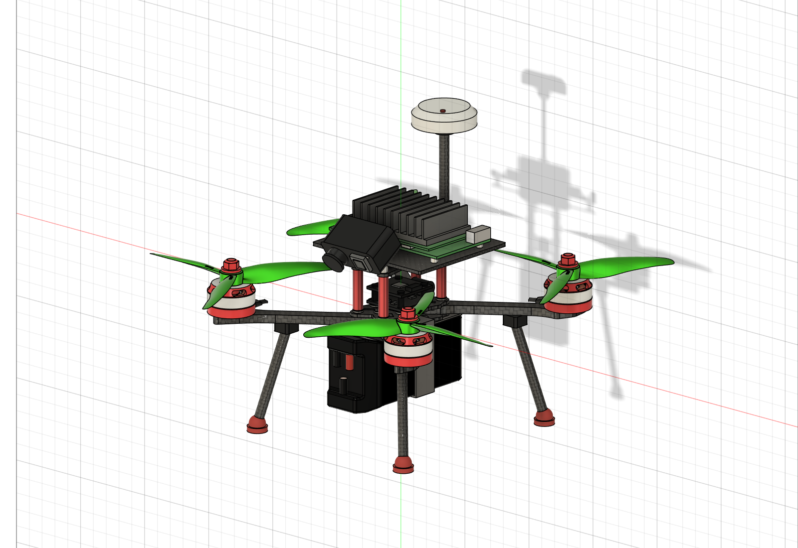
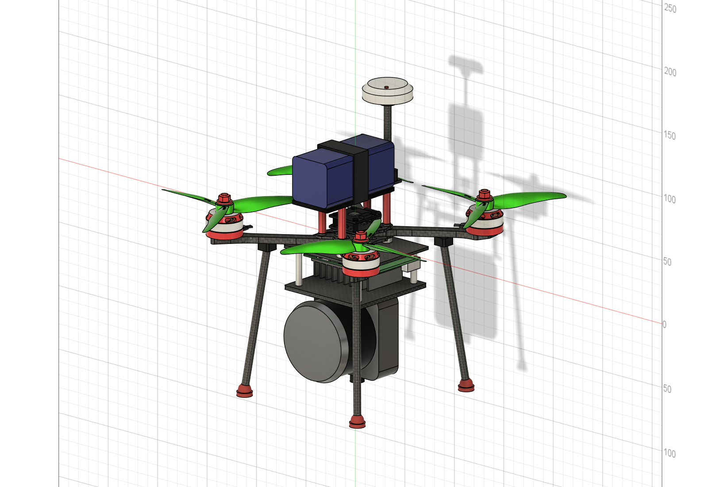
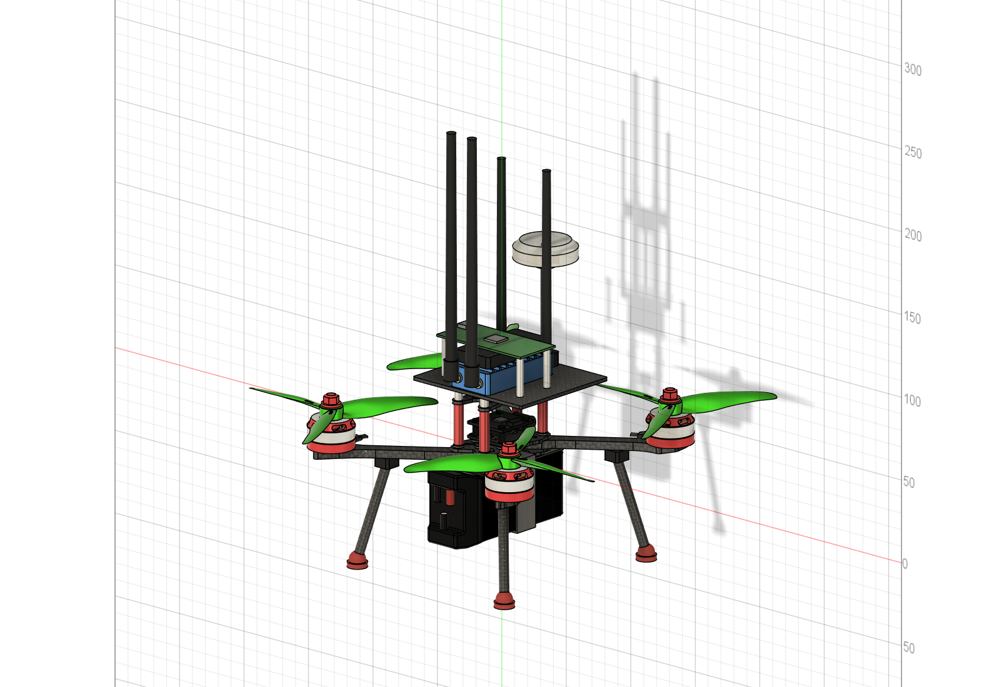
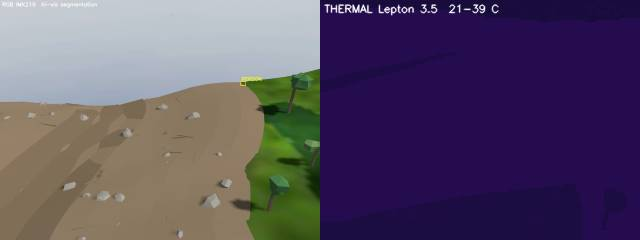
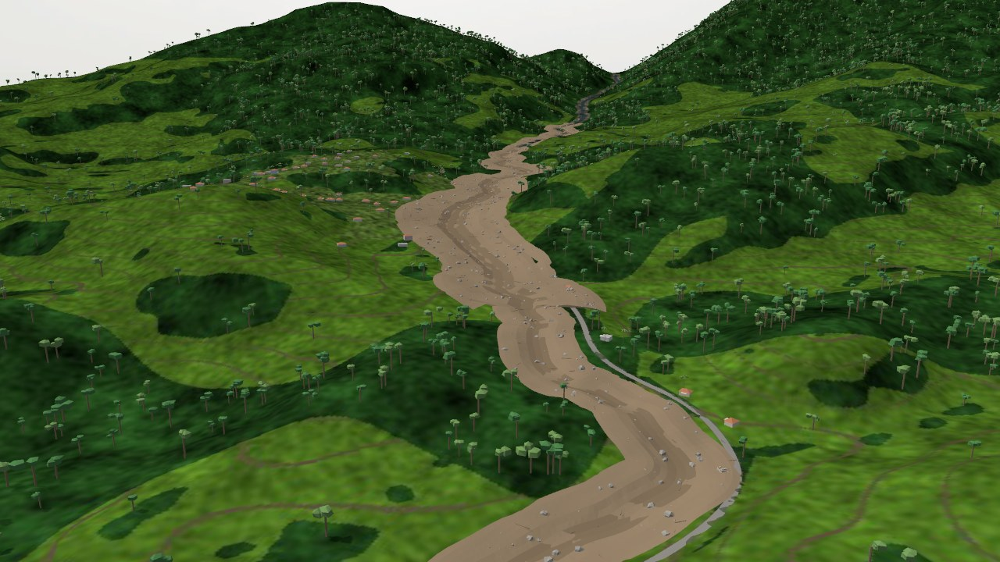
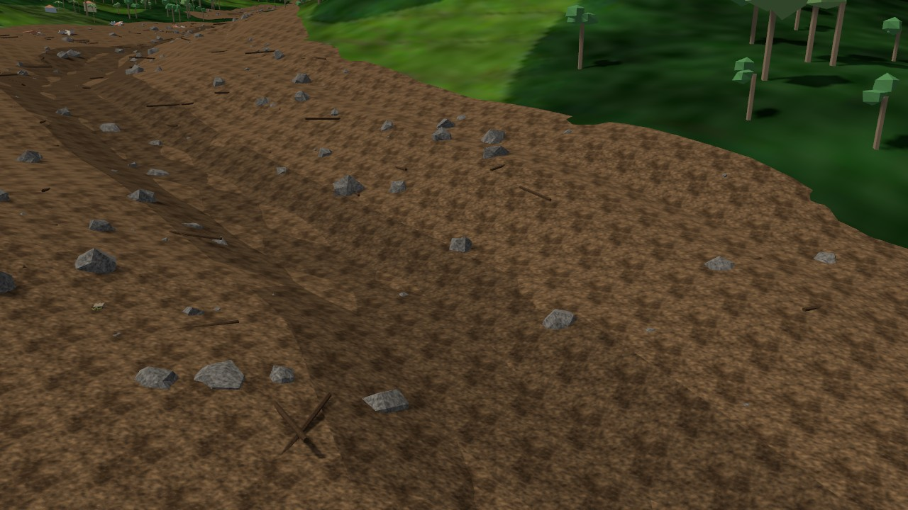

# ResQMesh

### A decentralised drone swarm that finds people after a landslide and keeps the rescue camp connected

**Team Apex · Hack-Orbital 2026 (Conscientia, IIST Thiruvananthapuram) · Problem statement S.3: Decentralized Drone
Swarm for Post-Disaster Search & Rescue and Ad-Hoc Mesh Relays**

**Live mission control:** [drone-swarm-s3.vercel.app](https://drone-swarm-s3.vercel.app) (watch a recorded mission
in the browser, no install needed)



---

## Contents
1. [The problem](#1-the-problem)
2. [Our solution](#2-our-solution)
3. [The swarm](#3-the-swarm)
4. [How a mission runs](#4-how-a-mission-runs)
5. [System architecture](#5-system-architecture)
6. [The simulation](#6-the-simulation)
7. [Mission control website](#7-mission-control-website)
8. [Results](#8-results)
9. [What makes it different](#9-what-makes-it-different)
10. [Limitations and honest notes](#10-limitations-and-honest-notes)
11. [Repository map](#11-repository-map)
12. [Running it yourself](#12-running-it-yourself)
13. [Roadmap](#13-roadmap)

---

## 1. The problem

At 2:17 AM on 30 July 2024, after extreme rain, a hillside above Mundakkai in Wayanad, Kerala failed. A debris flow
came down the river through Mundakkai and Chooralmala, buried houses and people, and washed away the Chooralmala
bridge, cutting the valley off by road.

Rescuers in a disaster like this face three problems at once:

- **Time.** The chance of finding a trapped person alive falls steeply with every day. Our Phase 1 research used a
  reported survival curve from the 1990 Philippines earthquake: about 88 % of trapped victims survive day 1, 35 %
  day 2 and 9 % day 3.
- **No map.** The ground the debris created has never been mapped. Old maps and satellite images show houses and a
  river that are no longer there.
- **No network.** Towers and power lines go down with the slope, so drones and teams on the ground cannot rely on
  mobile data or internet.

Buildings can be rebuilt. People can't. ResQMesh is built to find people in the first hours, where it matters most.

## 2. Our solution

ResQMesh is a swarm of small drones with three specialised roles that work as one team without a central controller
on the ground:

- **Scouts (the eyes)** fly low over the debris and find people with RGB and thermal cameras, processed on board.
- **Mappers (the brain)** fly higher, build a live 3D lidar map of the new ground, and run the planner that assigns
  work to every drone.
- **A Relay-Anchor (the voice)** hovers high over the swarm and links it to the rescue camp over a long-range radio.

Every drone is a node in an ad-hoc **mesh network**. A person spotted by a Scout becomes a GPS pin that hops drone to
drone to the Relay-Anchor and down to the camp. If any drone is lost, the mesh re-routes, the planner moves, and a
reserve drone takes over its work. The camp needs no internet: mission control runs locally and hands ground teams
coordinates and a walking route.

**Data path:** person seen → GPS pin → drone mesh → Relay-Anchor → long-range link → camp mission control → ground
teams (walkie-talkie fallback).

## 3. The swarm

Seven drones: 2 Scouts, 2 reserve Scouts on pads at the camp, 2 Mappers and 1 Relay-Anchor. All are custom designs
in Autodesk Fusion, built on the team's own frame.

| | Scout | Mapper | Relay-Anchor |
|---|---|---|---|
| Design |  |  |  |
| Job | Find people and geolocate them | Map the new ground in 3D; host the planner | Link the swarm to the camp |
| Sensors and compute | RGB + thermal camera head tilted 34° down, Jetson-class computer | 360° lidar under the frame, Jetson-class computer | Long-range radio modem, mesh node, small computer |
| Flies | 18 m above the mapped ground | 45 m above the ground | About 95 m, over the middle of the swarm |
| Count | 2 + 2 reserve | 2 | 1 |

The full component list, CAD checks and physical parameters are in [`sim/README.md`](sim/README.md). Hardware
parts are design choices for now; real masses and thrust come after the hackathon.

## 4. How a mission runs

1. **Alert.** The district control room raises the landslide alert. The camp tower floods it over the mesh, and the
   swarm launches from its pads.
2. **Link up.** The Relay-Anchor climbs and parks over the middle of the swarm, staying in line of sight of the camp
   tower.
3. **Map.** The Mappers fly offset passes along the debris corridor. Every lidar sweep goes into a voxel map and a
   ground surface, so the swarm knows the real shape of the new ground.
4. **Search.** A Scout sector opens once the map covers enough of it. Scouts sweep low over the mapped surface, each
   in its own altitude layer, with pass spacing set by the thermal camera's footprint.
5. **Detect (on board each Scout).**
   - Thermal: warm, person-sized blobs. A peak above 30 °C reads as **alive**; person-sized but cooler reads as
     **likely deceased**, a flag for the ground team to verify, never a medical verdict.
   - RGB: hi-vis clothing, confirmed over several frames. An RGB-only sighting sends the nearest Scout back to check
     it with thermal.
6. **Locate.** Every sighting is a bearing ray from the camera. The camp combines all the rays for one person (robust
   least squares), so views from different passes meet at the person. Pins are in standard GPS coordinates.
7. **Re-plan.** The planner (the Brain) runs on Mapper 1, with Mapper 2 as hot standby. It assigns sectors by
   optimal assignment of travel against where people are most likely to be, using a probability map updated by every
   sweep. Finished drones take over the far half of a teammate's work.
8. **Recover.** A crashed Scout is replaced by a reserve from the camp. If the Mapper running the Brain goes down,
   Mapper 2 takes over the plan. A drone with low battery hands its work back and flies home. If the Relay-Anchor is
   lost, the remaining drones form a chain of mesh relays back to the tower.
9. **Rescue route.** The camp plans the ground teams' walking route: living people first, then the deceased, with
   walking times over debris.
10. **Home.** When the search map is complete, every drone flies back to the camp and lands on its pad.



## 5. System architecture

```
                 ┌──────────────────────── Drone mesh (ad-hoc, multi-hop) ─────────────────────────┐
  Scout 1 ─┐                                                                                       │
  Scout 2 ─┼── detections, poses ──►  Mapper 1 (Brain)  ◄── hot standby ──►  Mapper 2              │
  Reserves ┘                          planner + search map                   lidar map             │
                                              │                                                    │
                                              ▼                                                    │
                                       Relay-Anchor  ──── long-range link (≈4 km) ────►  Camp tower│
                 └─────────────────────────────────────────────────────────────────────────────────┘
                                                                                          │
                                                                          Camp base station (ROS 2)
                                                                          triangulation, rescue route
                                                                                          │
                                                                          Mission-control website
                                                                          (local, no internet)
```

- **Swarm software:** ROS 2 Jazzy nodes in [`sim/ros2_ws/src/resqmesh_mission`](sim/ros2_ws/src/resqmesh_mission),
  for example `drone_agent` (per-drone behaviour), `brain` (planner), `story_detector` (on-board detection),
  `lidar_mapper`, `search_map`, `triangulate`, `rescue_route`, `base_station`.
- **Mesh:** `mesh_agent` runs on every drone and on the tower: distance-vector routing on a link-quality metric (as in
  the Babel protocol), hop-by-hop acknowledgements and retries, store-carry-forward for up to 180 s when no route
  exists, flooding for alerts, and service names (`brain`, `base`) that follow whichever drone holds the role.
  `radio_medium` models the channel: range limits and terrain line of sight on the real elevation map.
- **Flight:** PX4 autopilot on every drone (software-in-the-loop), controlled through `flight_agent`.
- **Mission control:** a React + Three.js website in [`sim/dashboard/app`](sim/dashboard/app).

## 6. The simulation

The Phase 2 build is a full simulation of the Mundakkai–Chooralmala landslide on the real terrain of the valley.

- **World:** Gazebo Harmonic, generated from a real elevation model of the Wayanad valley, with villages, forest,
  the river, the bridge and the rescue camp at Chooralmala.
- **Landslide:** the debris flow comes down the river in sequence, collapses houses, removes forest and washes the
  bridge away. People are placed in the debris; the seed decides where.
- **Drones:** each one is flown by its own PX4 autopilot, with wind (south-west monsoon, gusting), drag, GNSS error
  and realistic sensor noise on the thermal camera, RGB camera, lidar and IMU.
- **Failures on demand:** a motor failure can be injected into any drone mid-flight (`tools/damage.sh`).

| | |
|---|---|
|  |  |

## 7. Mission control website

The camp's view of the mission, at [drone-swarm-s3.vercel.app](https://drone-swarm-s3.vercel.app):

- **Story page:** the problem, the swarm in 3D (double-click a drone to see it exploded into its parts), the
  workflow, and short clips of key moments from the simulation.
- **Pre-recorded:** replays a full recorded mission exactly as the camp saw it.
- **Live:** connects to a running simulation on the same laptop through `tools/live_agent.py`.
- **Digital twin:** the valley in 3D with every drone, its route and the lidar map growing.
- **Mesh view:** every link and every hop a message takes back to the camp.
- **Report:** every person found, with condition, coordinates and the ground team's rescue route.

## 8. Results

From the recorded demo mission (sector Z4, the 166 m of the debris corridor nearest the camp, with 6 people placed,
2 of them deceased), scored against the simulation's ground truth:

| Measure | Result |
|---|---|
| People located | 5 of 6 |
| Condition (alive / likely deceased) | correct for all 5 |
| Duplicate pins | 0 |
| Pin error, triangulated from several views | 1.1–1.3 m (4 people) |
| Pin error, single view onto the ground | 2.2 m (1 person) |
| Area searched | 100 % of the sector |
| Failures survived | a Scout lost and replaced by a reserve; the Mapper running the Brain lost, Mapper 2 took over |
| Alert to every drone landed back at the camp | about 14 minutes |

These numbers come from one recorded run. The sixth person was not found in that run.

## 9. What makes it different

- **Specialised roles in one swarm.** To our knowledge, most swarm proposals use identical drones. ResQMesh splits
  the work: Scouts only look for people, Mappers only map and plan, the Relay-Anchor only keeps the link.
- **Search on a map that is built live.** Scouts fly over ground the Mappers have just measured, not over an
  out-of-date map.
- **No single point of failure.** The planner fails over between Mappers, the mesh re-routes around lost drones,
  reserves replace lost Scouts, and drones can rebuild the link to the camp themselves.
- **Works without internet.** Everything from detection to the rescue route runs on the drones and at the camp.
- **Alive vs likely deceased.** The camp knows whom to reach first.

## 10. Limitations and honest notes

- **Simulation, not hardware.** Everything here runs in simulation. Masses and thrust are class-typical values until
  real parts are weighed and a thrust stand is run.
- **The radio mesh is a link model**, with range, terrain line of sight and loss, not full radio propagation. The lidar
  map travels on the ROS 2 network rather than over the emulated radios.
- **Detection is simple by design.** The RGB detector finds hi-vis clothing, not a trained person model. Thermal reads
  surface temperature, so "no live heat" always means "check first".
- **Mapping uses the GNSS/INS pose**; a lidar-SLAM front end is future work.
- **Sensor rates are reduced** (thermal 4 Hz, RGB 2 Hz, lidar 12k points/s) to keep the simulation stable on a laptop.
- **The demo covers one sector** of the corridor so a whole mission fits in a presentation.

## 11. Repository map

| Path | What is there |
|---|---|
| [`sim/README.md`](sim/README.md) | Technical reference: algorithms, mesh, physics and sensor models, CAD checks, tests |
| [`sim/ros2_ws/`](sim/ros2_ws) | ROS 2 packages: `resqmesh_interfaces` (messages) and `resqmesh_mission` (all swarm nodes and tests) |
| [`sim/dashboard/`](sim/dashboard) | Mission-control website: built site, recorded replays, videos; source in `dashboard/app` |
| [`sim/models/`](sim/models), [`sim/worlds/`](sim/worlds) | Gazebo models (drones, terrain, villages, forest, camp, debris) and the world file |
| [`sim/config/`](sim/config) | Fleet, mission and vehicle parameters, terrain priors, Gazebo server config |
| [`sim/px4/`](sim/px4) | PX4 airframes for the three drone types |
| [`sim/cad_export/`](sim/cad_export) | Exports from the Fusion designs |
| [`sim/tools/`](sim/tools) | Run scripts, world and model generators, Fusion scripts, live agent, recorder |
| [`sim/setup/`](sim/setup) | Install and build scripts for WSL Ubuntu 24.04 |
| [`pitch/`](pitch) | Phase 1 deck (PDF, PPTX) and speaker script |

## 12. Running it yourself

**Watch a recorded mission (any computer):** open [drone-swarm-s3.vercel.app](https://drone-swarm-s3.vercel.app), or
serve the site locally:

```bash
cd sim/dashboard && python -m http.server 8080
```

then open http://localhost:8080/story.html.

**Run the full simulation** (Windows 11 with WSL Ubuntu 24.04 and an NVIDIA GPU): install with the scripts in
[`sim/setup/`](sim/setup), then from `sim/`:

```bash
wsl -d Ubuntu-24.04 -- bash ~/resqmesh/sim/tools/run_story.sh
```

```bash
wsl -d Ubuntu-24.04 -- bash ~/resqmesh/sim/tools/trigger.sh 19
```

The first command opens Gazebo on the camp and launches the swarm; the second triggers the landslide. Full
install steps, failure injection and recording are in [`sim/README.md`](sim/README.md).

**Run the tests:**

```bash
cd sim/ros2_ws/src/resqmesh_mission && python test/test_triangulate.py && python test/test_search_map.py
```

## 13. Roadmap

- Build and fly the three drone types, then replace the class-typical masses and thrust with measured values.
- Train a person detector for RGB and fuse it with thermal.
- Add lidar SLAM so mapping does not depend on GNSS.
- Test the mesh on real radios in hilly terrain.
- Scale beyond one sector and to other disasters: floods, earthquakes, collapsed buildings.

---

Team Apex · Hack-Orbital 2026
